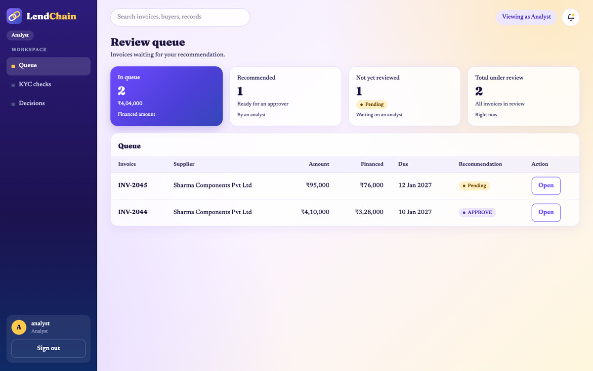
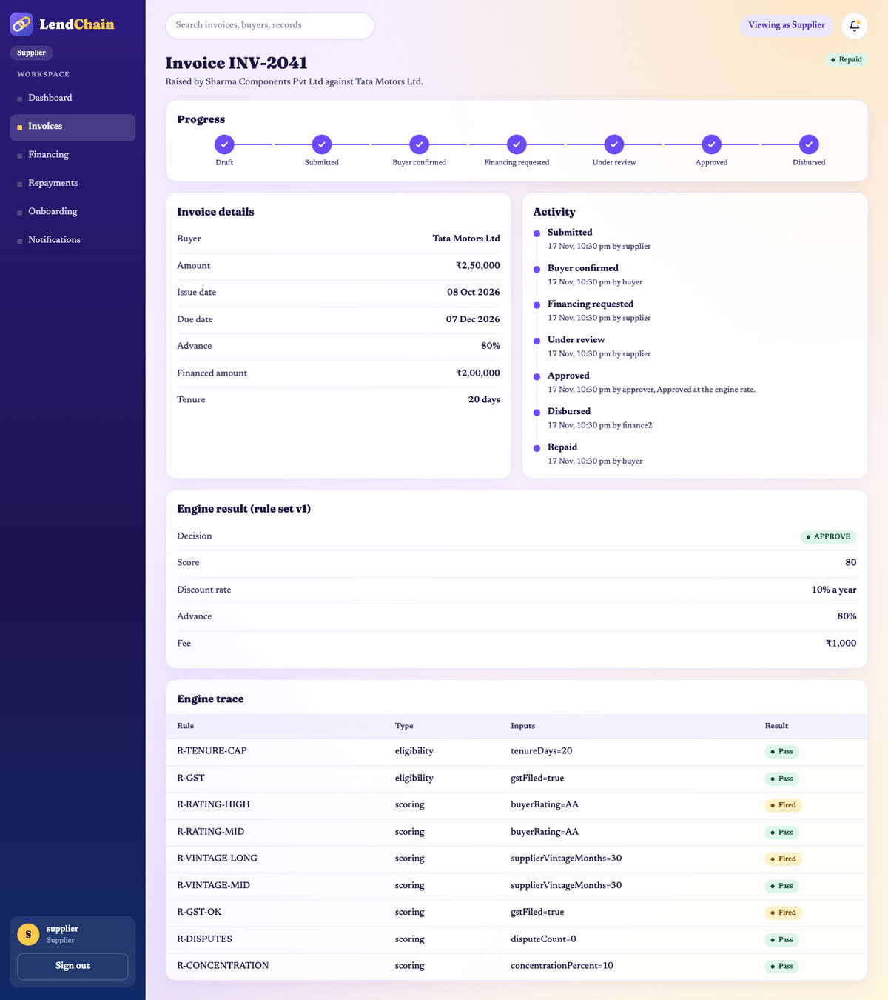
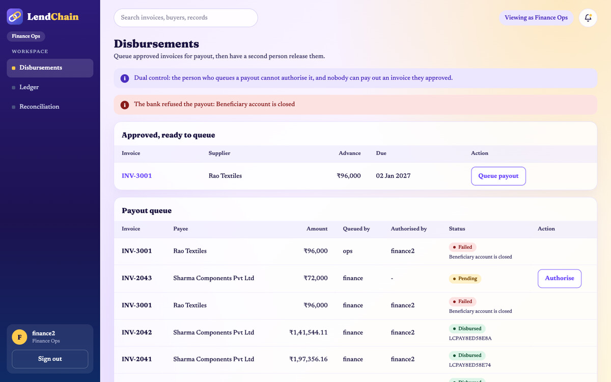
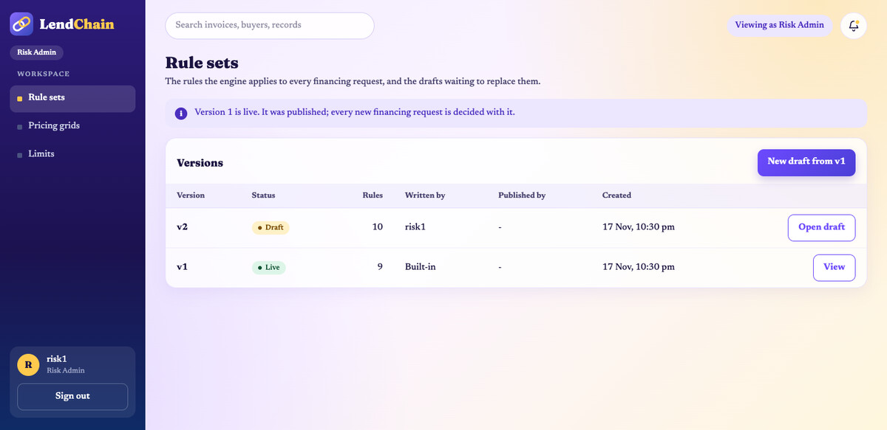
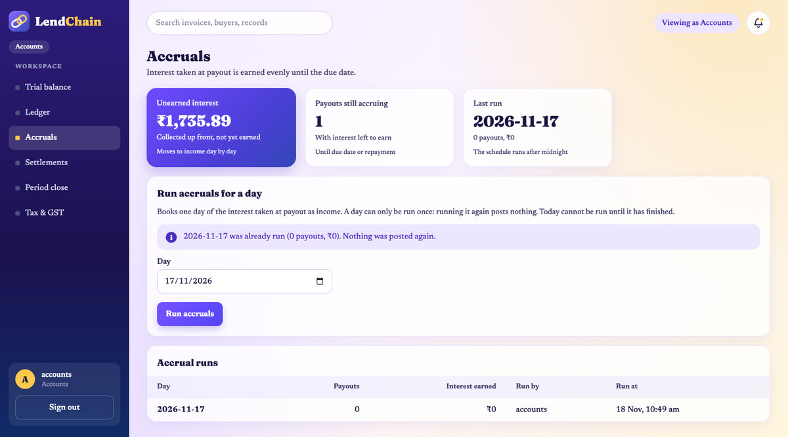
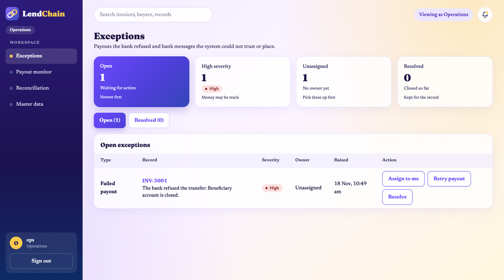
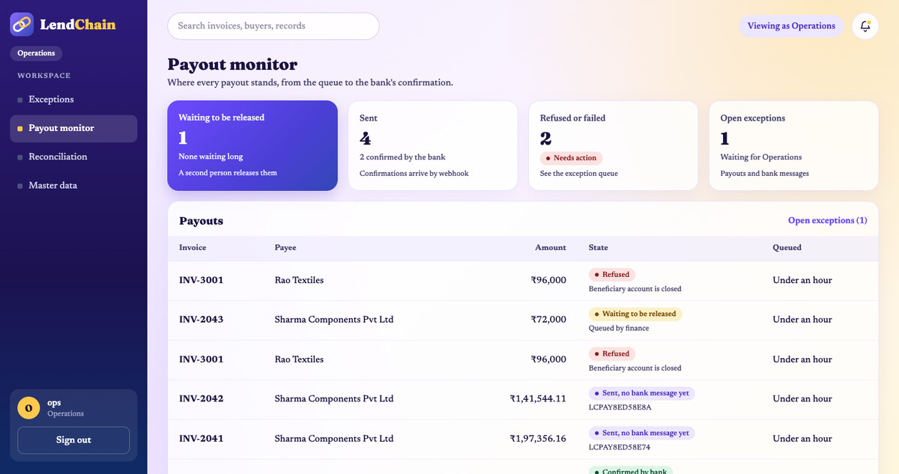
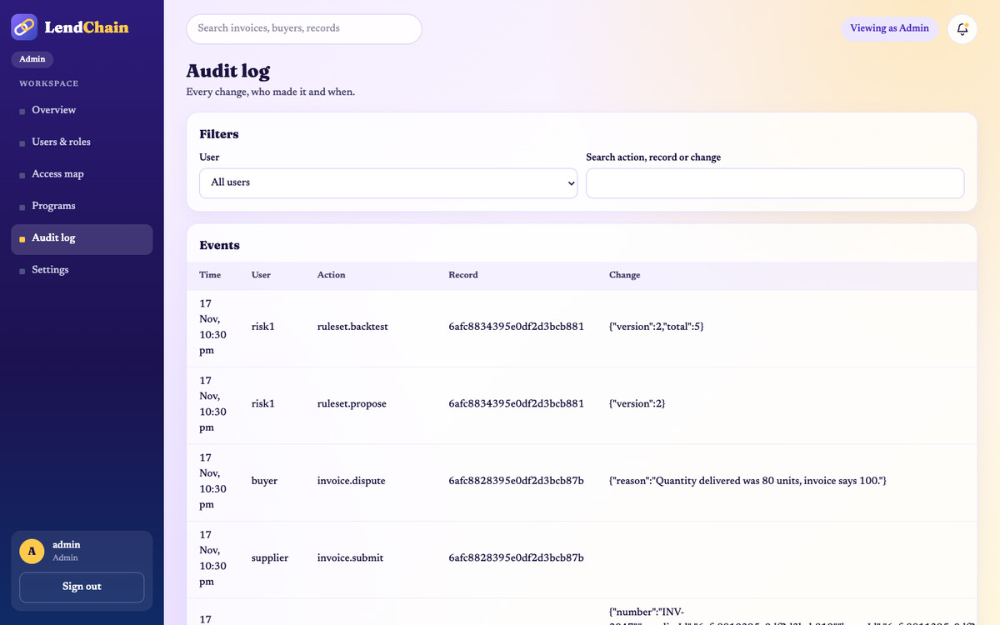
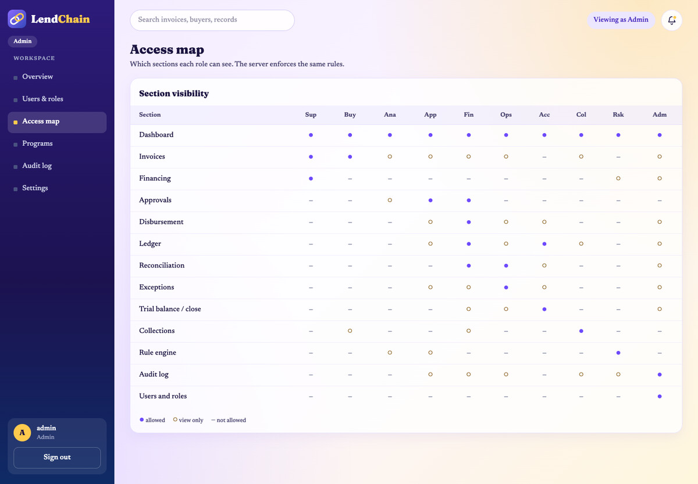

# LendChain

Supply chain finance platform. A supplier raises an invoice against a large buyer, the buyer confirms it, a rule engine scores and prices it, a credit officer approves it, finance disburses the money, and the buyer repays on the due date. Every step is role checked, audited and posted to a double-entry ledger.

Stack: Node.js, Express 5, TypeScript, MongoDB (Mongoose), React with Vite.

## Screenshots

Taken from the running app with the demo data. Each screen is shown for the role that uses it.

| | |
|---|---|
|  |  |
| Sign in | Supplier dashboard: limit, financed amount and recent invoices |
|  |  |
| Supplier invoice list | Buyer inbox: accept or dispute an invoice |
|  |  |
| Analyst review queue | Buyer payables and repayment |

**Invoice detail with the engine trace.** Every decision stores the rule set version, the facts and each rule that fired.



**Approver review.** The approver sees the engine result and the analyst recommendation. The server refuses an approval by the person who recommended it, or above their limit.


**Payouts with dual control.** One Finance Ops user queues a payout and a different one releases it.



**Rule engine.** Rule sets are versioned. A Risk Admin edits a draft and back-tests it against recent requests, and a second Risk Admin publishes it.




**Ledger and accounts.** Entries are append-only. The trial balance has no difference after every flow, interest taken at payout is earned day by day, and a month is closed by one accountant and signed off by another.





**Operations.** A payout the bank refuses goes to the exception queue and can be retried. Bank statements are uploaded as CSV and matched against the ledger.





**Audit log and access map.**




## Run locally

Needs Node 20.12 or newer.

```
cd server
npm install
npm run dev
```

With no `MONGO_URI` set, the server starts an in-memory MongoDB replica set and loads demo data. To use your own database or change a setting locally, copy `server/.env.example` to `server/.env`. Demo users are `supplier@`, `buyer@`, `analyst@`, `approver@`, `finance@`, `finance2@`, `ops@` (Operations), `accounts@`, `accounts2@`, `collections@`, `risk1@`, `risk2@` and `admin@` `lendchain.test`, all with the password `Demo@1234` on a local database. A hosted database uses the `DEMO_PASSWORD` you set.

```
cd client
npm install
npm run dev
```

The client expects the API at `http://localhost:5000` (override with `VITE_API_URL`).

## Client

React 19, Vite, TypeScript and Tailwind. Start the server first, then:

```
cd client
npm install
npm run dev
```

The dev server forwards `/api/*` to the API at `http://localhost:5000`. Set `API_TARGET` to point the proxy somewhere else, or `VITE_API_URL` to call an API directly.

Sign-in and the invoice flow use the real API: onboarding and KYC, programs, invoices, financing, buyer confirm or dispute, credit review, the two-step payout, repayment, notifications, rule sets (drafts, back-test, publish by a second reviewer) and the pricing grid, the ledger, trial balance, accruals and period close, exceptions, payout monitor and bank reconciliation, users and roles, access map and audit log. Collections ageing and the admin overview still show sample data from `src/data/sample.ts` and are marked "Sample data" in the page title.

Demo logins (password `Demo@1234`). The server has no second sign-in step yet.

| Role | Email |
|---|---|
| Supplier | `supplier@lendchain.test` |
| Buyer | `buyer@lendchain.test` |
| Analyst | `analyst@lendchain.test` |
| Approver | `approver@lendchain.test` |
| Finance Ops | `finance@lendchain.test` |
| Operations | `ops@lendchain.test` |
| Accounts | `accounts@lendchain.test` and `accounts2@lendchain.test` (period close needs two) |
| Collections | `collections@lendchain.test` |
| Risk Admin | `risk1@lendchain.test` |
| Admin | `admin@lendchain.test` |

Menus, routes and buttons follow the permission list the server returns at login. `src/lib/access.ts` holds the one small mapping from permission keys to the sections a role sees in full or read-only. These checks only change what the UI shows. They are not security: the server must enforce every permission and every maker-checker rule itself, whatever the client hides.

These menu items open a "coming soon" page: Repayments (buyer), Decisions, Approved, Rejected, Limits, Master data, Settlements, Tax & GST, Follow-ups, Overdue and Settings.

## Deploy

The API and the client deploy separately: MongoDB Atlas for the database, Render or Railway for the API, Vercel or Netlify for the web app. Nothing below needs a paid plan. The values are what the app needs; the hosts' dashboards change their wording from time to time.

### Environment variables

API (`server/.env.example` lists them all with comments):

| Variable | Required in production | Value |
|---|---|---|
| `NODE_ENV` | yes | `production` |
| `MONGO_URI` | yes | Atlas connection string, for example `mongodb+srv://<user>:<password>@<cluster>.mongodb.net/lendchain?retryWrites=true&w=majority` |
| `JWT_SECRET` | yes | at least 32 random characters, from `openssl rand -hex 32` |
| `BANK_WEBHOOK_SECRET` | yes | at least 16 random characters, from `openssl rand -hex 16` |
| `CLIENT_URL` | yes | the web app's address, for example `https://lendchain.vercel.app`. Several can be separated by commas. No wildcard, no trailing slash, https |
| `DEMO_PASSWORD` | when `SEED_ON_EMPTY` is on | password for the demo users, at least 8 characters |
| `SEED_ON_EMPTY` | no | `true` (default) loads the demo data when the database has no users. Set `false` for an empty database |
| `PORT` | no | the host sets it |
| `TRUST_PROXY` | no | number of proxies in front of the API, default `1` in production |

The API will not start in production if a required value is missing or weak. It prints every problem at once and exits.

Client:

| Variable | Value |
|---|---|
| `VITE_API_URL` | the API's address, for example `https://lendchain-api.onrender.com`, with no trailing slash. It is read when the client is built, so change it and redeploy |

### 1. MongoDB Atlas

1. Create a free cluster. Atlas clusters are replica sets, which payouts need because they use transactions.
2. Database Access: add a user with a strong password and the `readWrite` role on the `lendchain` database.
3. Network Access: allow the host to connect. Render and Railway free services have no fixed address, so this means `0.0.0.0/0`. Keep the database password strong and never reuse it.
4. Connect, then choose Drivers and copy the connection string. Put the user, password and the database name `lendchain` into it. That is `MONGO_URI`.

### 2. API on Render (or Railway)

| Setting | Value |
|---|---|
| Root directory | `server` |
| Build command | `npm install --include=dev && npm run build` |
| Start command | `npm start` |
| Health check path | `/health` |
| Environment | the API variables above |

`--include=dev` is there because the build uses TypeScript, which is a dev dependency. Both hosts accept the same settings: on Railway, set the root directory and the build and start commands in the service settings and add the variables in the Variables tab.

On first start with an empty database the API loads the demo users and data and logs `demo data: seeded`. Later starts log `demo data: users-exist` and leave the data alone. Run one instance: the demo load is guarded against two instances starting together, but the scheduled jobs are written for a single process.

### 3. Client on Vercel (or Netlify)

| Setting | Vercel | Netlify |
|---|---|---|
| Root / base directory | `client` | `client` |
| Build command | `npm run build` | `npm run build` (from `netlify.toml`) |
| Output directory | `dist` | `dist` (from `netlify.toml`) |
| Environment | `VITE_API_URL` | `VITE_API_URL` |

`client/vercel.json` and `client/netlify.toml` send every path to `index.html`, so a page can be opened or refreshed on any route. If `VITE_API_URL` is missing the build prints a warning, because the app would then call `/api` on its own address.

### 4. Connect them

The two sides need each other's address, so go in this order: Atlas, then the API (set `CLIENT_URL` to the address you expect for the client), then the client with `VITE_API_URL` set to the API's address. If the client's address turned out different, correct `CLIENT_URL` on the API and redeploy it. The API answers browsers only from the origins in `CLIENT_URL`.

Check it: `https://<api>/health` should return `{"ok":true,"db":"up",...}`, and the demo logins work on the client with `DEMO_PASSWORD`.

### Resetting the demo

To wipe the database and load a clean copy of the demo data, run this with the same environment variables the API uses (from your machine with `MONGO_URI` set, or in the host's shell):

```
cd server
npm run reset-demo -- --yes
```

Without `--yes` it only says which database it would wipe and stops.

### Things to know

- Free hosts put an idle API to sleep. The overdue and accrual jobs run inside the API process, so they only run while it is awake. Accruals can be run for any finished day from the Accruals screen, and running a day twice posts nothing, so a missed day is easy to make up.
- Sign-in attempts are limited to 10 failures per 15 minutes per address, on top of the five-failure account lock.
- The bank in this project is a mock. `BANK_WEBHOOK_SECRET` signs calls to `POST /webhooks/bank`; a real bank integration would need its own signing scheme.
- Running the built API on your machine: `cd server && npm run build`, then set the production variables and run `npm start`.

## Tests

```
cd server
npm test
```

Covers the rule engine, ledger, state machine, permission policy and the main workflow rules: supplier scoping, maker-checker, idempotent disbursement, balanced ledger, reproducible decisions and the concurrent limit check.

To run the whole invoice flow (draft to repaid, plus an overdue invoice, an escalation above the approver's limit, dual control and the audit log) against a fresh in-memory server:

```
cd server
npm run e2e
```

## Design notes

- Money is stored as integer paise.
- The ledger is append-only (updates and deletes are refused). Every transaction must balance, and the trial balance also checks each transaction on its own.
- Interest taken at payout is booked as unearned interest and moved to income one day at a time. A day can only be accrued once (its run record is unique and is written in the same transaction as the postings), and what is left is released when the invoice is repaid.
- A period is a calendar month. One accountant requests the close, a different one signs it off, and the month must have ended with a balanced trial balance. After that nothing can be posted into it: corrections are reversal entries dated in the open period.
- Payouts go through a mock bank that refuses accounts ending in `0000` (the seeded Rao Textiles account is one, so a failed payout can be shown). A refusal marks the payout failed, leaves the invoice approved, and creates an exception. Retrying queues a new payout that a different person still has to authorise.
- The bank webhook (`POST /webhooks/bank`) checks an HMAC signature over the raw body with `BANK_WEBHOOK_SECRET`. A bad signature, an unreadable body or an unknown payout reference becomes an exception instead of being trusted.
- Reconciliation takes a CSV (`date,reference,description,debit,credit`). A line matches a ledger cash entry by reference and amount, or by amount and date when there is a single candidate, and no entry is matched twice. A demo statement with a few deliberate differences can be generated from the ledger.
- The rule engine is a pure module. Rules live in the database as JSON and are versioned; every evaluation stores the rule set version, the facts and the full trace.
- Program limits are reserved with a single conditional update so parallel requests cannot go over the limit.
- Disbursement, ledger posting and the status change run in one MongoDB transaction.
