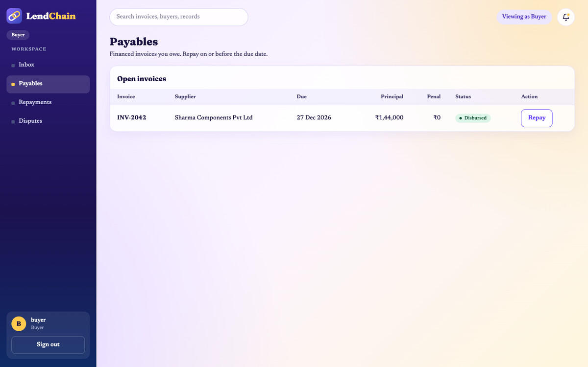

# LendChain

Supply chain finance platform. A supplier raises an invoice against a large buyer, the buyer confirms it, a rule engine scores and prices it, a credit officer approves it, finance disburses the money, and the buyer repays on the due date. Every step is role checked, audited and posted to a double-entry ledger.

Stack: Node.js, Express 5, TypeScript, MongoDB (Mongoose), React with Vite.

## Screenshots

Taken from the running app with the demo data. Each screen is shown for the role that uses it.

| | |
|---|---|
|  |  |
| Sign in | Supplier dashboard: limit, financed amount and recent invoices |
|  |  |
| Supplier invoice list | Buyer inbox: accept or dispute an invoice |
|  |  |
| Analyst review queue | Buyer payables and repayment |

**Invoice detail with the engine trace.** Every decision stores the rule set version, the facts and each rule that fired.


**Approver review.** The approver sees the engine result and the analyst recommendation. The server refuses an approval by the person who recommended it, or above their limit.


**Payouts with dual control.** One Finance Ops user queues a payout and a different one releases it.


**Rule engine.** Rule sets are versioned. A Risk Admin edits a draft and back-tests it against recent requests, and a second Risk Admin publishes it.


**Audit log and access map.**


## Run locally

Needs Node 20.

```
cd server
npm install
npm run dev
```

With no `MONGO_URI` set, the server starts an in-memory MongoDB replica set and loads demo data. Demo users are `supplier@`, `buyer@`, `analyst@`, `approver@`, `finance@`, `finance2@`, `ops@` (Operations), `accounts@`, `collections@`, `risk1@`, `risk2@` and `admin@` `lendchain.test`, all with the password `Demo@1234`.

```
cd client
npm install
npm run dev
```

The client expects the API at `http://localhost:5000` (override with `VITE_API_URL`).

## Client

React 19, Vite, TypeScript and Tailwind. Start the server first, then:

```
cd client
npm install
npm run dev
```

The dev server forwards `/api/*` to the API at `http://localhost:5000`. Set `API_TARGET` to point the proxy somewhere else, or `VITE_API_URL` to call an API directly.

Sign-in and the invoice flow use the real API: onboarding and KYC, programs, invoices, financing, buyer confirm or dispute, credit review, the two-step payout, repayment, notifications, rule sets (drafts, back-test, publish by a second reviewer) and the pricing grid, users and roles, access map and audit log. Ledger, Operations, Accounts, Collections and the admin overview still show sample data from `src/data/sample.ts` and are marked "Sample data" in the page title.

Demo logins (password `Demo@1234`). The server has no second sign-in step yet.

| Role | Email |
|---|---|
| Supplier | `supplier@lendchain.test` |
| Buyer | `buyer@lendchain.test` |
| Analyst | `analyst@lendchain.test` |
| Approver | `approver@lendchain.test` |
| Finance Ops | `finance@lendchain.test` |
| Operations | `ops@lendchain.test` |
| Accounts | `accounts@lendchain.test` |
| Collections | `collections@lendchain.test` |
| Risk Admin | `risk1@lendchain.test` |
| Admin | `admin@lendchain.test` |

Menus, routes and buttons follow the permission list the server returns at login. `src/lib/access.ts` holds the one small mapping from permission keys to the sections a role sees in full or read-only. These checks only change what the UI shows. They are not security: the server must enforce every permission and every maker-checker rule itself, whatever the client hides.

These menu items open a "coming soon" page: Repayments (buyer), Decisions, Approved, Rejected, Limits, Payout monitor, Master data, Settlements, Tax & GST, Follow-ups, Overdue and Settings.

## Tests

```
cd server
npm test
```

Covers the rule engine, ledger, state machine, permission policy and the main workflow rules: supplier scoping, maker-checker, idempotent disbursement, balanced ledger, reproducible decisions and the concurrent limit check.

To run the whole invoice flow (draft to repaid, plus an overdue invoice, an escalation above the approver's limit, dual control and the audit log) against a fresh in-memory server:

```
cd server
npm run e2e
```

## Design notes

- Money is stored as integer paise.
- The rule engine is a pure module. Rules live in the database as JSON and are versioned; every evaluation stores the rule set version, the facts and the full trace.
- Program limits are reserved with a single conditional update so parallel requests cannot go over the limit.
- Disbursement, ledger posting and the status change run in one MongoDB transaction.
- The ledger repository only inserts. Corrections are reversals.
